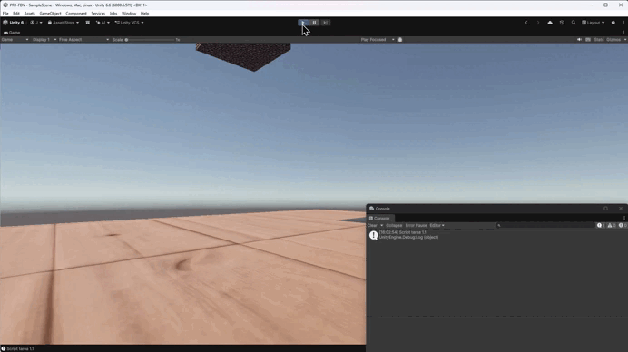
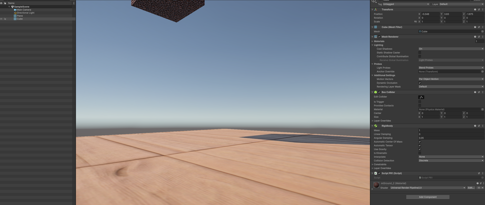
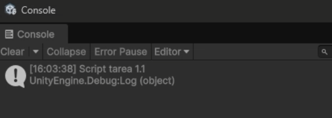
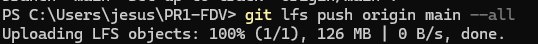

# Práctica 1: Control de Versiones con Git LFS en Unity


## Descripción y Requisitos de la Práctica

Esta práctica abarca los siguientes apartados técnicos:
1. **Proyecto Unity y Objetos 3D:** Creación de un entorno 3D en Unity que incluye dos objetos geométricos.
2. **Materiales y Flujo de Trabajo:** Creación y asignación de materiales independientes para cada objeto siguiendo el flujo de trabajo estándar del motor.
3. **Control de Versiones Git y Git LFS:** Inicialización de un repositorio Git limpio (excluyendo carpetas temporales como `Library/` mediante el `.gitignore` oficial de Unity) y configuración de Git LFS con su respectivo fichero `.gitattributes`.
4. **Archivo Multimedia y Script de C#:** Inclusión de un archivo multimedia superior a 100 MB ubicado en la carpeta multimedia del proyecto y desarrollo de un script en C# configurado para mostrar el mensaje correspondiente en la consola de Unity.

---

## Demostración en Vídeo / GIF Animado



---

## Capturas de Pantalla del Proceso

### 1. Jerarquía de Unity con los objetos y el script asignado


### 2. Consola de Unity mostrando el mensaje de la práctica


### 3. Subida y verificación de Git LFS en la terminal


---

## Configuración del Fichero `.gitattributes` (Git LFS)

El fichero `.gitattributes` situado en la raíz del proyecto define las reglas de seguimiento de los archivos pesados:

```text
# Git LFS Track Rules
*.mp4 filter=lfs diff=lfs merge=lfs -text
*.psd filter=lfs diff=lfs merge=lfs -text
*.fbx filter=lfs diff=lfs merge=lfs -text
*.unitypackage filter=lfs diff=lfs merge=lfs -text
*.gif filter=lfs diff=lfs merge=lfs -text
